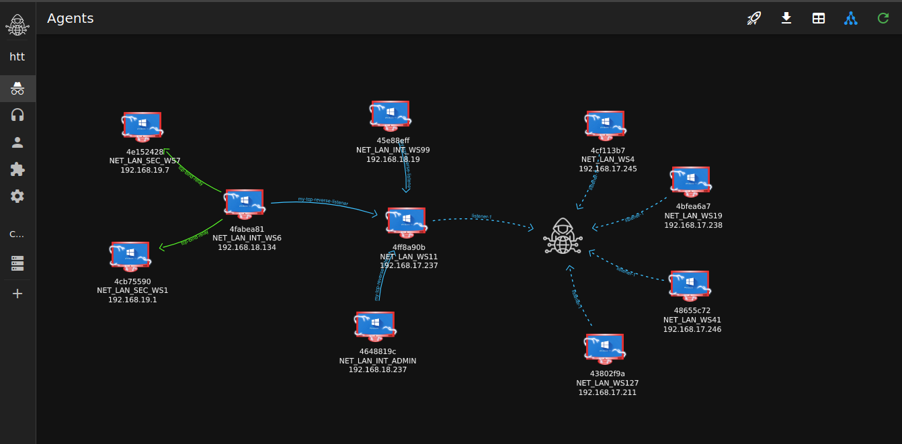
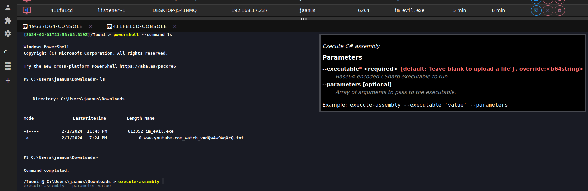

<!-- markdownlint-configure-file {
  "MD013": {
    "code_blocks": false,
    "tables": false
  },
  "MD033": false,
  "MD041": false
} -->

<div align="center">


# Tuoni

[](https://discord.gg/fd8caSs8Vj)
[](https://docs.tuoni.io/)

Tuoni is a cross-platform red teaming framework built for cyber defense exercises and security training. It provides a browser-based interface, a modular plugin system, and streamlined reporting — deployed through Docker in minutes.

</div>

---

## Features

- **Browser-based UI** — Operate from any machine, no client installation required
- **Modular plugins** — Extend and tailor capabilities to fit specific exercise needs
- **Docker-native** — Consistent, reproducible deployment on Debian, Ubuntu, and Kali Linux
- **Built for scale** — Designed for large-scale exercises with multiple concurrent operators
- **Offline-capable** — Optional bundled documentation service for air-gapped environments

---

## Screenshots





---

## Prerequisites

- **OS:** Debian, Ubuntu, or Kali Linux
- **Architecture:** x86_64 or ARM64
- **Docker:** 25.0.0 or later — installed automatically if missing
- **Network:** Outbound internet access for the initial image pull
- `wget` or `curl` must be available

---

## Installation

```bash
wget -O - https://tuoni.sh | bash
cd /srv/tuoni
```

Or with curl:

```bash
curl https://tuoni.sh | bash
cd /srv/tuoni
```

Running the installer again will update Tuoni to the latest version. The Tuoni service will restart automatically.

### Configuration changes during upgrades

Upgrades reconcile managed configuration files with changes to their examples
before stopping services. Application and client `start` and `restart` commands
also reconcile configuration before starting containers. Currently this covers
`nginx/tuoni.conf` and `nginx/example/example.tuoni.conf`. It applies to any example
change, including the WebSocket proxy headers required by newer clients; those
headers remain compatible with client **0.16.1**.

| Configuration state | Upgrade behavior |
| --- | --- |
| Example unchanged | Preserve the active file, including customizations. |
| Example changed; active file matches the previous example | Back up the active file and install the new example automatically, including in silent mode. |
| Example changed; active file was customized | Prompt to **replace**, **keep**, or **abort** (default). Silent upgrades fail unless forced. |
| Previous example unavailable or unverified | Recognize defaults from local release tags; otherwise require review or force, unless the active file already matches the new example. |

The listen port from `config/tuoni.yml` is preserved. Configuration-only updates
restart the client and nginx. Choosing **keep** acknowledges the new example;
you must merge required changes yourself, and the same example will not prompt
again. Keeping a customized file means you have checked that it includes changes
required by the new release. Aborting preserves the active file and running
services, but does not undo the Git pull or a version change already made by an
older updater.

To back up and replace conflicting files during a silent upgrade:

```bash
tuoni update-silent --force-config
```

For older CLI versions, or the installer, use the equivalent environment flag:

```bash
TUONI_FORCE_CONFIG=1 tuoni update-silent
curl https://tuoni.sh | SILENT=1 TUONI_FORCE_CONFIG=1 bash
```

**Force replaces the entire conflicting file; it does not merge customizations.**
Each replacement saves the original as `nginx/tuoni.conf.bak.<unique suffix>`.
Unchanged examples still preserve customizations, even with force enabled.

#### Pinned upgrades and recovery from 0.16.1

The 0.16.1 CLI can write `TUONI_VERSION` into `config/tuoni.env` before pulling
new scripts, then skip its upgrade steps because the versions already match.
The installer's final `tuoni start` now checks the active nginx file independently
of those version values. It recognizes old shipped defaults by comparing their
contents with examples from local release tags, retaining the configured port.
This also repairs stock 0.16.1 files on installations already marked as 0.17.0.

Accepted examples are recorded in `config/.example-state/v2/`. Older snapshots
are rechecked because they may have recorded the new example without updating
the active file. A customized file may therefore need a one-time review, even
if the old updater reported success. Silent operation fails until that review
or an explicit force replacement; it does not silently discard customizations.

Once the checkout contains these updated scripts, recover an existing
installation with:

```bash
cd /srv/tuoni
SILENT=1 ./tuoni start
```

If a customized file blocks recovery, manually merge the required changes and
run `./tuoni start` interactively to review it, or authorize a full replacement:

```bash
SILENT=1 TUONI_FORCE_CONFIG=1 ./tuoni start
```

Required nginx restarts are recorded on disk before configuration changes and
cleared only after nginx is recreated and `nginx -t` succeeds. If startup fails
or is interrupted, rerunning `tuoni start` retries the pending restart. A direct
update started by the old CLI still needs a subsequent `tuoni start` to execute
the new startup checks; the installer already performs that step.

### Silent / Automated Install

Set `SILENT=1` to run without any prompts — useful for provisioning scripts or CI pipelines:

```bash
export SILENT=1
curl https://tuoni.sh | bash
```

### Environment Variables

| Variable                    | Default                                  | Description                                    |
| --------------------------- | ---------------------------------------- | ---------------------------------------------- |
| `SILENT`                    | _(unset)_                                | Set to `1` to skip prompts; unresolved configuration conflicts fail the upgrade |
| `NO_UPDATE`                 | _(unset)_                                | Set to `1` to skip updating the app on re-run  |
| `TUONI_FORCE_CONFIG`        | _(unset)_                                | Set to `1` to back up and replace conflicting managed files when their examples change or the previous example is unavailable |
| `TUONI_USERNAME`            | `tuoni`                                  | Initial admin username                         |
| `TUONI_PASSWORD`            | _(autogenerated)_                        | Initial admin password                         |
| `TUONI_DOCKER_IPV6_ENABLED` | `false`                                  | Enable IPv6 on the Docker network              |
| `TUONI_REPO` ⚗️             | `https://github.com/shell-dot/tuoni.git` | Source repository override                     |
| `TUONI_BRANCH` ⚗️           | `main`                                   | Branch to install from                         |
| `TUONI_VERSION` ⚗️          | _(unset)_                                | Pin a specific version                         |
| `TUONI_SUDO_COMMAND` ⚗️     | `sudo --preserve-env=...`                 | Override the sudo invocation (see note below)   |
| `TUONI_CONTAINER_REPO` ⚗️   | `ghcr.io`                                | Container registry or proxy for pulling images |

> ⚗️ Experimental — intended for development and testing only.

> **Note on `TUONI_SUDO_COMMAND`:** the default uses `sudo --preserve-env=<list>`
> to retain Tuoni's Compose inputs, Docker connection and TLS settings, Compose
> project settings, and proxy/package-manager configuration. It works with classic
> sudo on Ubuntu/Kali and sudo-rs shipped with Ubuntu 25.10/26.04. The standalone
> installer uses a smaller list for package installation.
> Do not override it with `sudo -E`: sudo-rs ignores `-E`, causing Compose to lose
> Tuoni's runtime settings. Custom overrides replace the complete sudo invocation;
> include all required names in `--preserve-env=VAR1,VAR2` (no spaces). Set
> `TUONI_SUDO_COMMAND=''` to run without sudo. When adding runtime variables to the
> Compose file, also add them to the list in `scripts/_init.sh`.

If `wget` or `curl` are not installed, add them first:

```bash
sudo apt-get install -y wget curl
```

---

## Getting Started

After installation, open the URL printed by the installer in your browser and log in with the credentials shown during setup.

The `tuoni` CLI manages the running services:

```bash
tuoni help
```

Full documentation is at [docs.tuoni.io](https://docs.tuoni.io/).

---

## Community

Questions, feedback, or want to get involved? Join us on [Discord](https://discord.gg/fd8caSs8Vj).

---

## Acknowledgements

Tuoni is built on top of a number of excellent open-source projects. See [ACKNOWLEDGEMENTS.md](ACKNOWLEDGEMENTS.md) for details.
